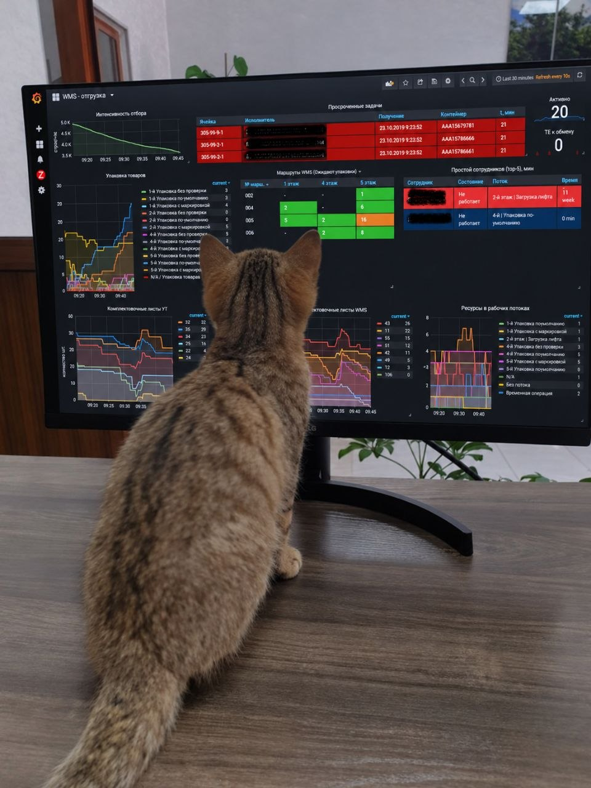
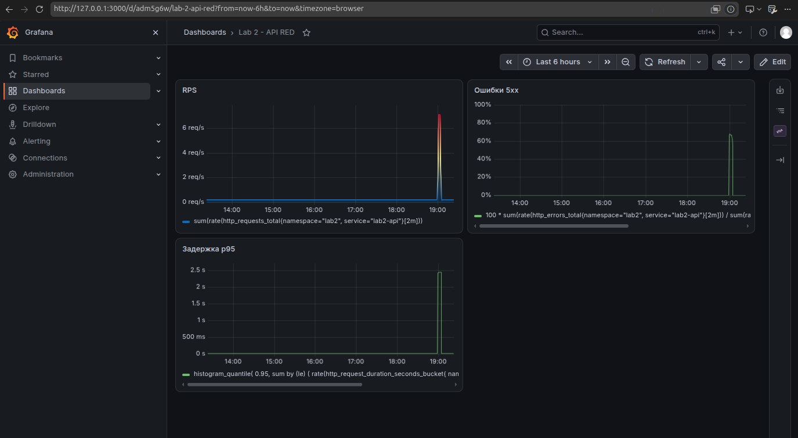
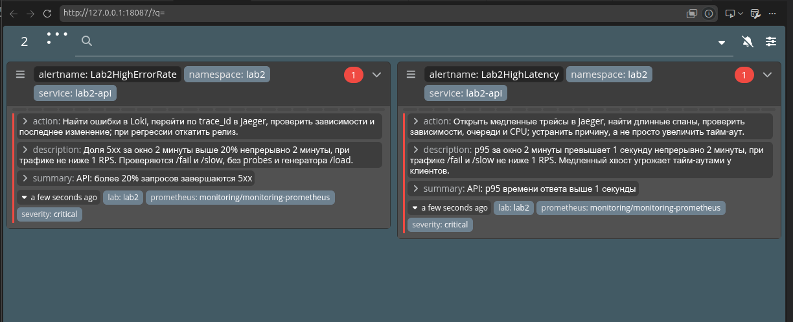
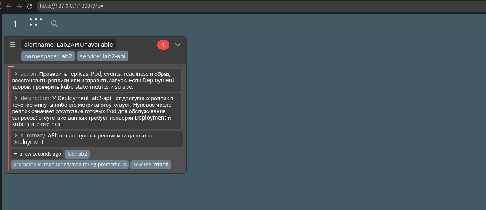

# Лабораторная работа № 2 — наблюдаемость и мониторинг API

[Условие лабораторной работы](https://github.com/KeladKaal/containerization-and-orchestration/blob/main-rus/lecture-2-observability/lab.md).



В этой лабе настроил наблюдаемость Go API в Кубере: метрики, логи, трейсы
и алерты. Для проверки специально нагружал сервис, вызывал ошибки
и медленные ответы, а затем смотрел, как это мониторится.

По RED-графикам выявил симптомы, в Локи уже конкретную ошибку, в джагере
ее трейс. В конце проверил три критичных алерта и доставку уведомлений.

## Стенд и конфиги

Использовал kind-кластер `itmo-observability`: API в namespace `lab2`,
остальной стек — в `monitoring`. Все компоненты развернул через Helm.

| Компонент | Конфигурация |
| --- | --- |
| Go API | [Код и Dockerfile](api), [chart](charts/lab2-api) |
| Prometheus, Grafana, Alertmanager | [Базовые values](observability/monitoring-values.yaml), [маршрутизация алертов](observability/monitoring-alerts-values.yaml) |
| Loki и Alloy | [Loki values](observability/loki-values.yaml), [Alloy values](observability/alloy-values.yaml) |
| Jaeger | [Chart](charts/lab2-jaeger), [OTLP-настройки API](observability/api-tracing-values.yaml) |
| Karma | [Chart](charts/lab2-karma) |

Сигналы идут разными путями:

```text
API /metrics → Prometheus → Grafana: RED
                   ↓
              Alertmanager → webhook
                   ↓
                 Karma
API stdout   → Alloy → Loki → Grafana: логи
API OTel     → Jaeger: трейсы
```

## Часть 0 — очередной API

Для экспериментов сделал небольшой сервис на Go с нужными ручками:

| Запрос | Поведение |
| --- | --- |
| `GET /health` | `200 OK`, тело `ok` |
| `GET /fail` | Намеренная 500-ка, счетчик ошибок и ошибочный спан |
| `GET /slow` | Задержка 2 секунды внутри спана `slow-op` |
| `GET /load` | Пачка HTTP-запросов к собственному API |
| `GET /metrics` | Метрики Прометеуса |

Для RED добавил три метрики:

| Метрика | Тип |
| --- | --- |
| `http_requests_total` | Counter запросов |
| `http_errors_total` | Counter ответов 5xx |
| `http_request_duration_seconds` | Histogram длительностей |

Сервис пишет JSON-логи с `trace_id` и инструментирован OpenTelemetry.

## Часть 1 — метрики и RED-дашборд

Прометеус собирает метрики по ручке `/metrics` каждые 15 секунд через
[ServiceMonitor](charts/lab2-api/templates/servicemonitor.yaml),
включенный в [scrape-values](observability/api-scrape-values.yaml).
Target API появился в состоянии `UP`, запрос
`up{namespace="lab2", service="lab2-api"}` вернул `1`.

Это подтверждает сбор метрик, но не успех всех ручек, т. к.
`/fail` при этом продолжает намерено отдавать 500-ку.

### RED в Графане

Создал дашборд `Lab 2 - API RED` с источником `Prometheus`
и тремя панелями: RPS, доля 5xx и p95 времени ответа.

RPS, запросов в секунду:

```promql
sum(rate(http_requests_total{namespace="lab2", service="lab2-api"}[2m]))
```

Доля ошибок, %:

```promql
100 *
sum(rate(http_errors_total{namespace="lab2", service="lab2-api"}[2m]))
/
sum(rate(http_requests_total{namespace="lab2", service="lab2-api"}[2m]))
```

p95, секунды:

```promql
histogram_quantile(0.95,
  sum by (le) (
    rate(http_request_duration_seconds_bucket{namespace="lab2", service="lab2-api"}[2m])
  )
)
```

Счетчики показываю через `rate` за двухминутное окно, а
p95 — это оценка границы для 95% запросов.

### Проверка нагрузкой

Вызвал обычные, ошибочные и мееедленные запросы:

```console
$ curl --max-time 10 -sS 'http://127.0.0.1:18080/load?n=100&concurrency=5'
{"path":"/health","requested":100,"attempted":100,"succeeded":100,"failed":0}
$ curl --max-time 10 -sS 'http://127.0.0.1:18080/load?n=20&concurrency=5&path=/fail'
{"path":"/fail","requested":20,"attempted":20,"succeeded":0,"failed":20}
$ curl --max-time 20 -sS 'http://127.0.0.1:18080/load?n=20&concurrency=5&path=/slow'
{"path":"/slow","requested":20,"attempted":20,"succeeded":20,"failed":0}
```

До нагрузки виден только фон от probes: около `0.2 RPS` и `0%` ошибок.


После пачек RPS вырос примерно до `1.5 req/s`, доля 5xx в окне —
до `30%`, p95 — до `2.4 s`.


В RED учитываются также `/health` и родительский `/load`, поэтому доля
ошибок не равна простому отношению размеров пачек. p95 приближенный:
задержка чуть больше 2 секунд попадает в бакет до `2.5 s`.

После ручной настройки сохранил
[JSON дашборда](charts/lab2-grafana-config/dashboards/lab2-api-red.json)
и подключил его через [Helm chart](charts/lab2-grafana-config).



## Часть 2 — логи: Alloy, Loki и Графана

Alloy поставил как DaemonSet для сбора stdout подов.
Локи хранит собранные логи и отвечает на запросы из той же Графаны.

Дернул `/fail` и нашел ошибку в Explore:

```logql
{namespace="lab2", service="lab2-api"} | json | level="ERROR"
```

В записи: `request failed`, `GET /fail`, `status=500`.
`trace_id=d753c3fa88bf46055db257e14447d5d4` совпал
с заголовком `X-Trace-ID` в HTTP-ответе.


`trace_id` оставил полем JSON, а не меткой Локи, чтобы не создавать
отдельный поток на каждый запрос. Для поиска использую `| json`.

Намеренная 500-ка оставила след.

## Часть 3 — трейсы в Jaeger

Поднял Jaeger и направил в него OTLP-экспорт из API.
Повторил запросы `/slow` и `/fail`.

У `GET /slow` длительность около `2 s` и два спана:
корневой HTTP-запрос и вложенный `slow-op`.
В водопаде видно, что почти все время ушло в медленную операцию.


У `GET /fail` один спан, `83 µs`, статус `500` и отметка ошибки.


Затем нашел ошибку в Локи и открыл ее трейс по тому же ID:

```logql
{namespace="lab2", service="lab2-api"}
  | json
  | trace_id="a26977cd71fe84287249e304a689ccf1"
```

В логе и джагере совпали `trace_id` и `span_id=47a2fcc0f2881194`.
Так связались конкретный HTTP-запрос, строка лога и ошибочный спан.


## Часть 4 — алерты, получатель и Karma

### Три критичных правила

Настроил [правила](charts/lab2-alerts/files/alert-rules.yaml),
по которым дежурному действительно нужно реагировать:

| Алерт | Условие | Почему важно и что делать |
| --- | --- | --- |
| `Lab2HighErrorRate` | 5xx >20% за окно 2 минуты, непрерывно 2 минуты; трафик ≥1 RPS | Запросы завершаются ошибками. Найти их в Локи, проверить трейсы, зависимости и последний релиз; при регрессии откатить |
| `Lab2HighLatency` | p95 >1 секунды за окно 2 минуты, непрерывно 2 минуты; трафик ≥1 RPS | Риск клиентских тайм-аутов. По длинным спанам проверить зависимости, очереди и CPU, устранить узкое место |
| `Lab2APIUnavailable` | Нет доступных реплик Deployment или его метрика отсутствует непрерывно 1 минуту | Запросы некому обслуживать либо потеряна видимость состояния сервиса. Проверить Pod, events, readiness и образ; при отсутствии метрики — также KSM и scrape |

В правилах ошибок и задержки исключил `/health` и `/load`,
чтобы probes и сам генератор не искажали пользовательские показатели.
Окно `rate(...[2m])` задает расчет скорости, `for: 2m` требует
устойчивого нарушения. Порог `1 RPS` защищает от случайных высоких
процентов при единичных запросах.

### Срабатывания и доставка

Алертменеджер принимает алерты от Прометеуса, группирует их
и отправляет в [Go webhook](alert-receiver).
[Маршрут](observability/monitoring-alerts-values.yaml) настроил
для критичных алертов этой лабы.

Для ошибок и задержки запустил четырехминутную нагрузку:

```bash
bash scripts/trigger-alerts.sh 240
```

Оба алерта появились в Алертменеджере:


Недоступность проверил отдельно: уменьшил число реплик API до нуля.
KSM продолжал отдавать `kube_deployment_status_replicas_available=0`,
и правило сработало.


Доставку подтвердил в логах webhook. Значимые поля сообщений:

```jsonl
{"status":"firing","receiver":"lab2-webhook","alertname":"Lab2HighErrorRate"}
{"status":"firing","receiver":"lab2-webhook","alertname":"Lab2HighLatency"}
{"status":"firing","receiver":"lab2-webhook","alertname":"Lab2APIUnavailable"}
{"status":"resolved","receiver":"lab2-webhook","alertname":"Lab2APIUnavailable"}
```

После проверки восстановил API. Для всех трех алертов пришли
и `firing`, и `resolved`: проверил не только UI, но и реальную доставку.

### Karma

Подключил Karma к Алертменеджеру и повторил те же эксперименты.
Сначала увидел ошибки и высокую задержку:



Затем недоступность API:



Все три правила дошли до Кармы. Она показывает готовые алерты:
их вычисление остается в Прометеусе, доставка уведомлений в Алертменеджере.


## Итог

Получился связанный стек: по метрикам увидел проблему, по логам нашел
запрос, по трейсу уже операцию. Три критичных ситуации
попали в Алертменеджер и Karma, уведомления дошли до получателя, а до меня — эти бесценные знания.