# Лабораторная работа № 4 - scheduling и ресурсы

Задание: [Лаба 4. SLA критического пути под перегрузкой](https://github.com/KeladKaal/containerization-and-orchestration/blob/main-rus/lecture-4-scheduling-resources/lab.md).

Критический путь это заказ: `api` и Postgres. `batch` это ночная аналитика, под перегрузкой ей можно пожертвовать. Кластер `lab4` на две ноды, у worker свободно 2 CPU. Настройки лежат в чарте `shop`.

## Оглавление

1. [Часть 1 - разнесение реплик](#часть-1---разнесение-реплик)
2. [Часть 3 - числа krr](#часть-3---числа-krr)
3. [Часть 4 - реплики api на разных нодах](#часть-4---реплики-api-на-разных-нодах)
4. [Часть 5 - приоритеты и гарантии](#часть-5---приоритеты-и-гарантии)
5. [Часть 6 - Pending и вытеснение](#часть-6---pending-и-вытеснение)
6. [Часть 7 - выселение по памяти](#часть-7---выселение-по-памяти)
7. [Часть 8 - SLA под нагрузкой](#часть-8---sla-под-нагрузкой)
8. [Часть 9 - три алерта](#часть-9---три-алерта)

## Часть 1 - разнесение реплик

В `values.yaml` параметр `spread.mode` выбирает `podAntiAffinity` или `topologySpread`.

`podAntiAffinity` запрещает двум подам с одной меткой стоять на одной ноде. Реплик `api` три, нод две, третья навсегда останется `Pending`.

`topologySpread` выравнивает число подов. При `maxSkew: 1` перекос не больше одного пода, три реплики встают как 2 и 1 и все `Running`. Если перекос вышел бы больше, под не ставится, а не сваливается на одну ноду.

Я выбрала `topologySpread` потому что критическому пути нужны все три реплики. Разнесение при этом остаётся: падение одной ноды не забирает весь `api`.

## Часть 3 - числа krr

До замера в чарте была догадка. У `api` и `worker` только лимиты `100m` / `64Mi`, запроса не было, Kubernetes приравнял бы его к лимиту. У `batch` запрос `100m` / `64Mi`, лимит `500m` / `256Mi`. У Postgres лимиты `500m` / `512Mi`.

Нагрузка через `hey` на `POST /order`. Полные две минуты не отработала, я остановила её через Ctrl+C.

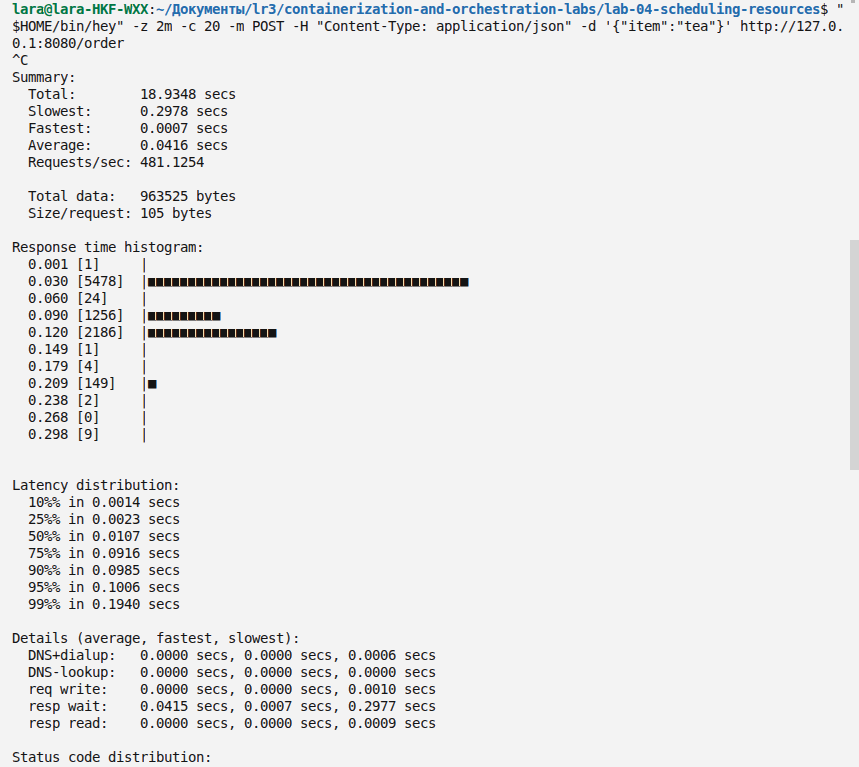

18.9 секунды, 481 запрос/с, p95 0.10 с, в полном выводе `[201] 9110 responses`.

`krr` смотрит потребление и считает запрос CPU как 95-й перцентиль, память как максимум плюс 15%. Лимит CPU он оставляет пустым.

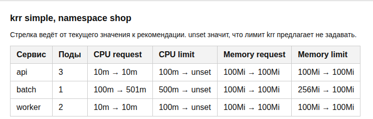

Postgres в таблице нет, `krr` не видит объект Cluster. Снимок сделан уже после записи чисел, слева от стрелки не догадка.

| Сервис | Было | Рекомендация krr |
| --- | --- | --- |
| `api` | лимит 100m / 64Mi, запроса нет | CPU request 10m, CPU limit пустой, память 100Mi |
| `worker` | то же | то же |
| `batch` | запрос 100m / 64Mi, лимит 500m / 256Mi | CPU request 501m, CPU limit пустой, память 100Mi |

10m и 100Mi это пол `krr`, ниже он не ставит. 501m у `batch` появились потому, что цикл упирается в лимит 500m. Пустой CPU limit в чарт не перенесла: Kyverno такой под отклоняет. Запрос 501m тоже не записан, он выше лимита.

В чарт ушло: у `api` и `worker` запрос `10m` / `100Mi`, лимит CPU оставлен `100m`, память `100Mi`. У `batch` запрос памяти `100Mi`, запрос CPU так и `100m`, лимиты `500m` / `256Mi`.

Для Postgres те же величины сняты в Prometheus.

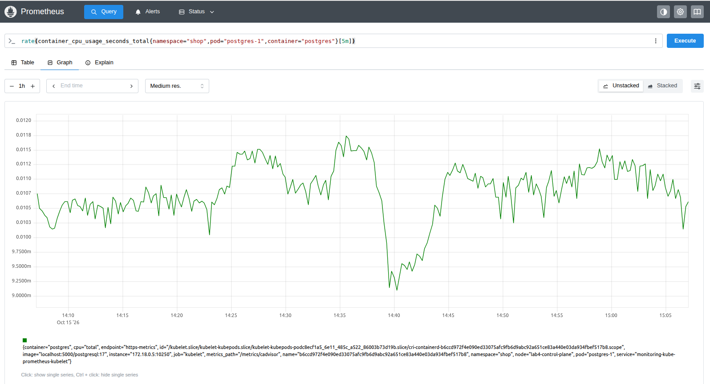

Около 10-12m.

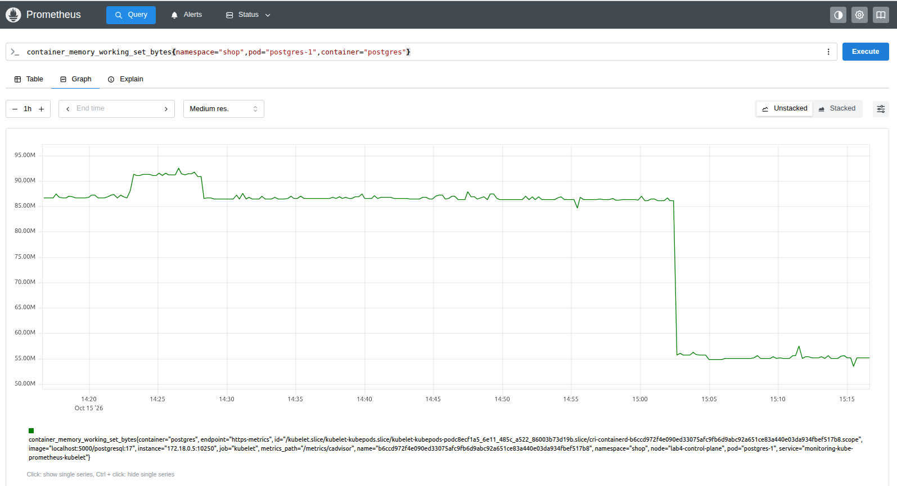

Около 86-91M. Догадка `500m` / `512Mi` сильно выше простоя.

## Часть 4 - реплики api на разных нодах

Режим из части 1 подключён к `api`.

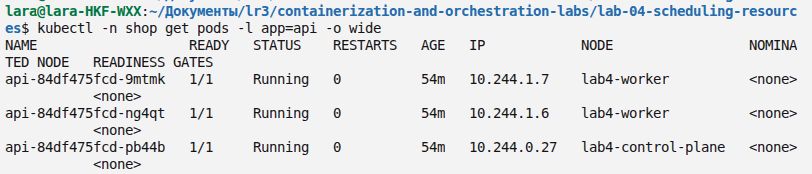

Два пода на worker, один на control plane. Если одна нода пропадёт, на второй реплика останется и заказ не остановится целиком.

## Часть 5 - приоритеты и гарантии

QoS считается сам. `requests` равны `limits` по CPU и памяти, это `Guaranteed`. Запрос ниже лимита, это `Burstable`. Под давлением по памяти kubelet сначала забирает `Burstable`: у него есть запас между запросом и лимитом. `Guaranteed` обещан весь его лимит, он в конце очереди.

`PriorityClass` это явное число, его смотрит уже планировщик. Больше число, выше приоретет. `PodDisruptionBudget` не даёт при плановом сбое снять сразу все реплики.

`api` и Postgres получили `shop-critical` со значением `1000000` и `Guaranteed`. У `api` это `10m` / `100Mi`, число запроса из части 3. У Postgres простой был около 10-12m и 86-91M, но на `20m` / `100Mi` под не стал `1/1`: проба не успевала. Подняла вместе до `200m` / `256Mi`, класс остался `Guaranteed`.

`batch` оставлен `Burstable`: запрос `100m` / `100Mi`, лимит `500m` / `256Mi`. Класс `shop-background` со значением `-10`, ниже пода без класса. Иначе фон оказался бы выше `worker`.

PDB у `api`: минимум 2 из трёх реплик. У Postgres: минимум 1, единственный под снимать нельзя.

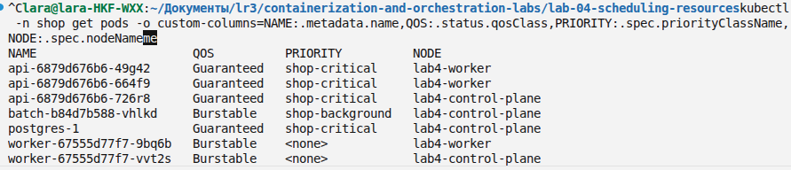

`api` и `postgres` имеют класс `Guaranteed` и приоритет `shop-critical`. `batch` имеет класс `Burstable` и приоритет `shop-background`. У `worker` приоритет пустой, то есть 0.

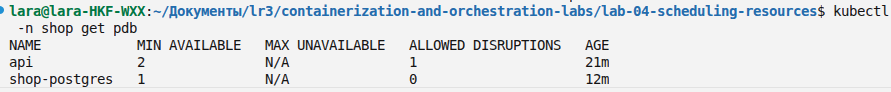

У `api` можно убрать одну реплику. У `shop-postgres` нельзя убрать ни одной.

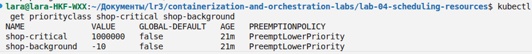

`1000000` и `-10`. Класс по умолчанию на весь кластер не подменён.

## Часть 6 - Pending и вытеснение

Планировщик считает место по `requests`, не по тому, сколько процесс реально ест. У `batch` реплик стало 3, запрос и лимит CPU стали `8`. Цикл занимает одно ядро, но зарезервировано восемь.

```text
batch-b84d7b588-vhlkd   1/1  Running   lab4-control-plane
batch-db7d9c5fb-47xn9   1/1  Running   lab4-control-plane
batch-db7d9c5fb-4kxzq   0/1  Pending   <none>
batch-db7d9c5fb-kpjwr   1/1  Running   lab4-control-plane
```

Два новых пода сели на control plane, третий `Pending`. На worker 8 CPU больше, чем есть у ноды. На control plane два таких запроса забирают 16, третьему нехватает. Приоритет `batch` равен `-10`, снимать некого: `Preemption is not helpful`.

Дальше вытеснение. Запрос `api` подняла до `3`, spread на этот шаг выключила, иначе реплика ушла бы на worker и не влезла в его 2 CPU. На control plane свободно около 2.3 CPU, новый под входит только если снять один `batch`.

```text
Preempted         pod/batch-db7d9c5fb-47xn9  Preempted by pod c1541cb5-2ecd-4a08-ac04-31e7b089514c on node lab4-control-plane
FailedScheduling  pod/api-b49965b68-mgb9h    preempting 1 victims
```

Планировщик снял `batch` и посадил `api`. В событии жертвы указан uid пода `api`, не его имя. Замена `batch` снова стала `Pending`: место уже заняли реплики `api`.

После проверки запрос `api` вернула к `10m`, spread снова `topologySpread`.

## Часть 7 - выселение по памяти

Потребление `batch` поднято через values. Лимит контейнера 8Gi, выше того, что процесс успевает занять, поэтому его собственный cgroup не закрывает его раньше kubelet. Запрос памяти 100Mi, класс `Burstable`, приоритет `-10`. Под сидит на worker, у этой ноды порог `memory.available<256Mi`.

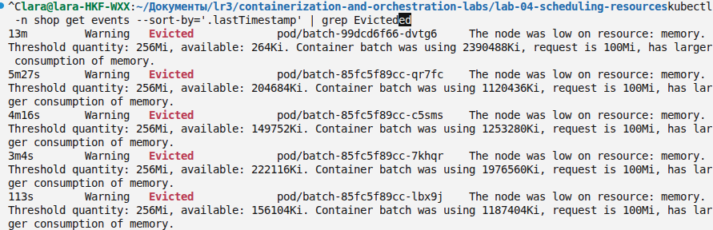

Причина `Evicted`. Порог 256Mi, свободно доходило до 264Ki. Контейнер держал до 2390488Ki при запросе 100Mi. Kubelet забрал `batch`: он съел больше своего запроса и стоит ниже остальных. `api` и Postgres остались `Running`.

`OOMKilled` это другой диагноз с тем же симптомом, под завершился. Его пишет ядро, когда процесс упёрся в свой memory cgroup. `Evicted` пишет kubelet: памяти не хватило ноде, и она выбрала наименее защищённый под.

## Часть 8 - SLA под нагрузкой

Я сформулировала SLA так: 95% ответов `POST /order` с нормальным телом быстрее 300 мс, ответов 5xx нет.

На лимите CPU `10m` это не выполняется. Короткий прогон около 10 запросов в секунду дал p95 1.36 с: cgroup режет процесс раньше, чем он пишет заказы. Запрос и лимит CPU у `api` подняла вместе до `200m`. Класс остался `Guaranteed`.

Дальше `hey` шёл волнами, между волнами пауза.

| Волна | Запросов/с | p95 | Коды |
| --- | --- | --- | --- |
| тихая | 16.0 | 17 мс | 400 раз `201` |
| средняя | 69.6 | 149 мс | 2092 раз `201` |
| битое тело | 24.0 | 3 мс | 360 раз `400` |
| пик | 142.9 | 168 мс | 4323 раз `201` |
| спад | 12.0 | 20 мс | 240 раз `201` |

На нормальных заказах p95 ниже 300 мс ответов 5xx нет. Столбик `400` это отдельная волна с телом `not-json`, путь заказа не сломался. Деградирует `batch`: его память держится около 64Mi и обрывается, когда под снимают под алерт. CPU `api` повторяет ступени заказов, CPU Postgres низкий.

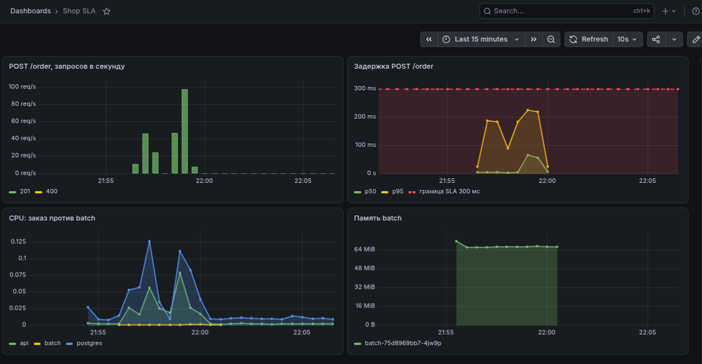

## Часть 9 - три алерта

Три новых правила, не копия третьей лабы. Метка `release: monitoring`, иначе тот же Prometheus их не подхватит.

`ShopOrderLatencyHigh` срабатывает, если 95% `POST /order` дольше 300 мс в течении двух минут. Это прямая граница SLA.

`ShopBatchPending` срабатывает, если под `batch` минуту не может сесть. Так видно, что места не хватило фону, а не заказу.

`ShopBatchEvicted` срабатывает, если у пода `batch` причина `Evicted`. Это выселение из части 7, не `OOMKilled` по своему лимиту.

Дашборд `Shop SLA` лежит в чарте, sidecar Grafana забирает его сам.

Чтобы поймать firing, у `batch` на время снимка запрос CPU стал `1800m` и обязательная привязка к worker. Из 2 CPU там уже занято около 610m, под остаётся `Pending`. Через минуту `ShopBatchPending` переходит в firing. Два других молчат.

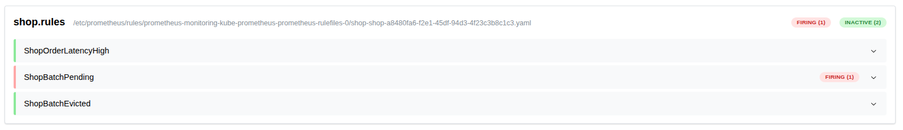

После снимка значения `batch` вернула к файлу: запрос `100m`, лимит `500m`, `nodeName: lab4-worker`.
