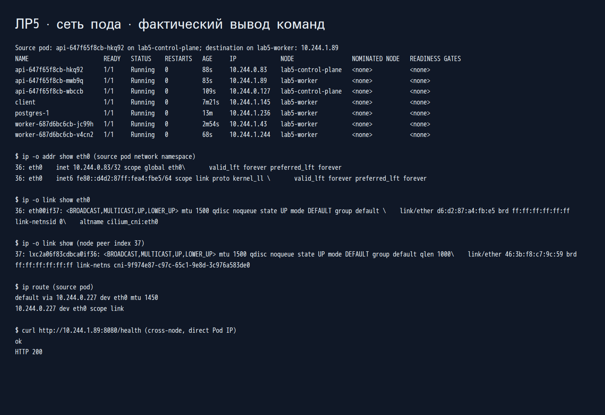
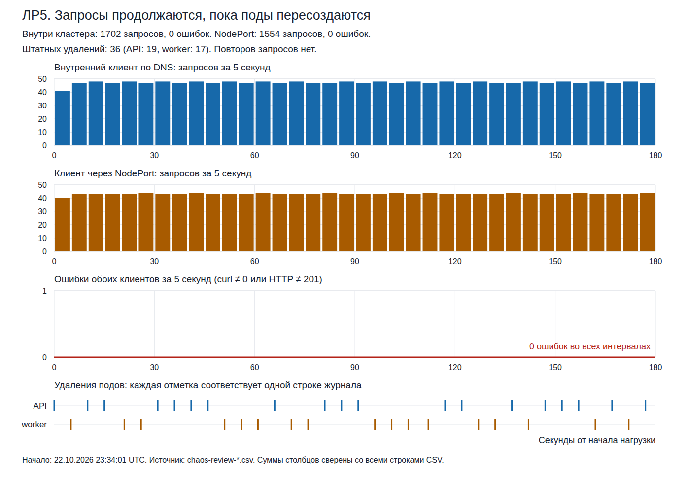
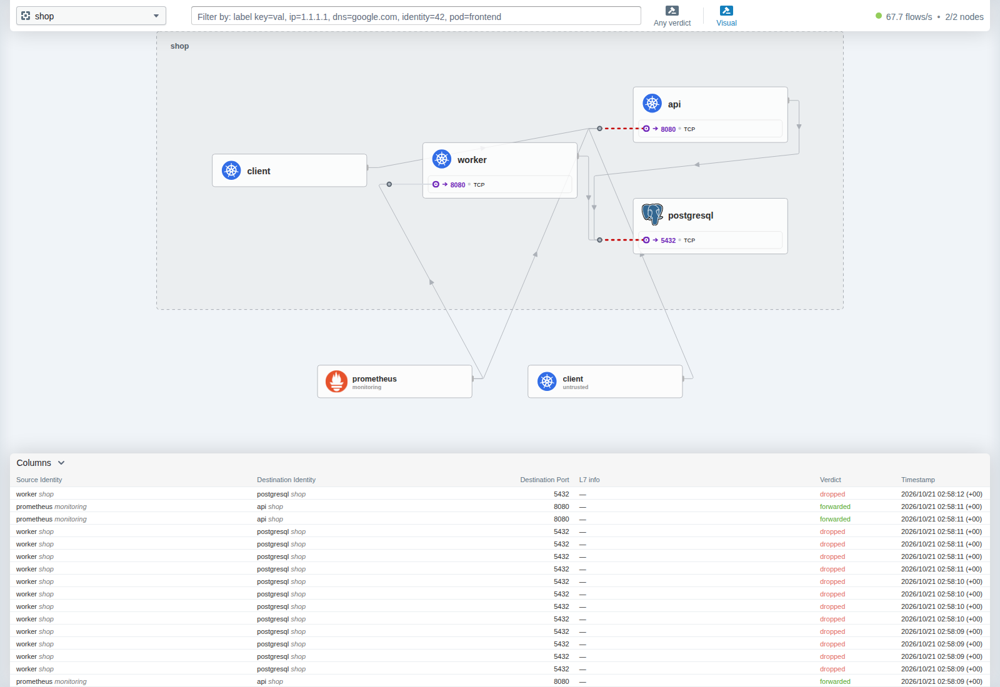
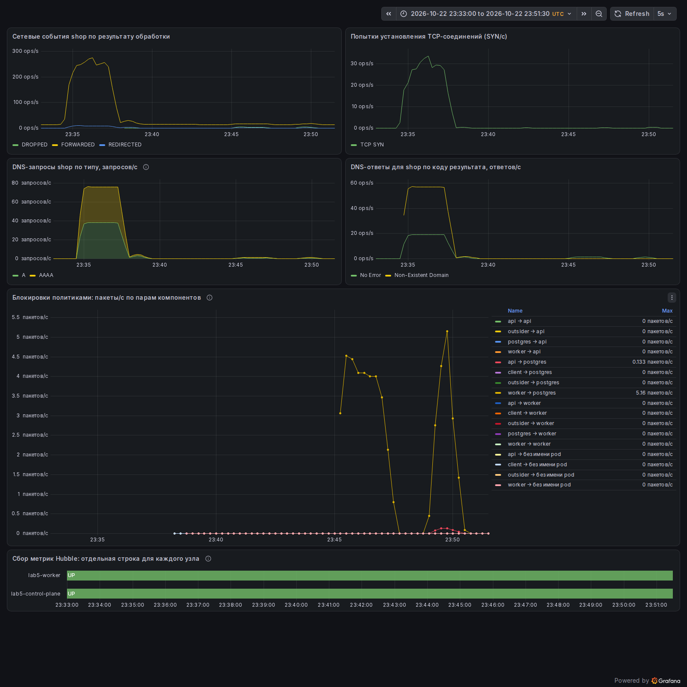
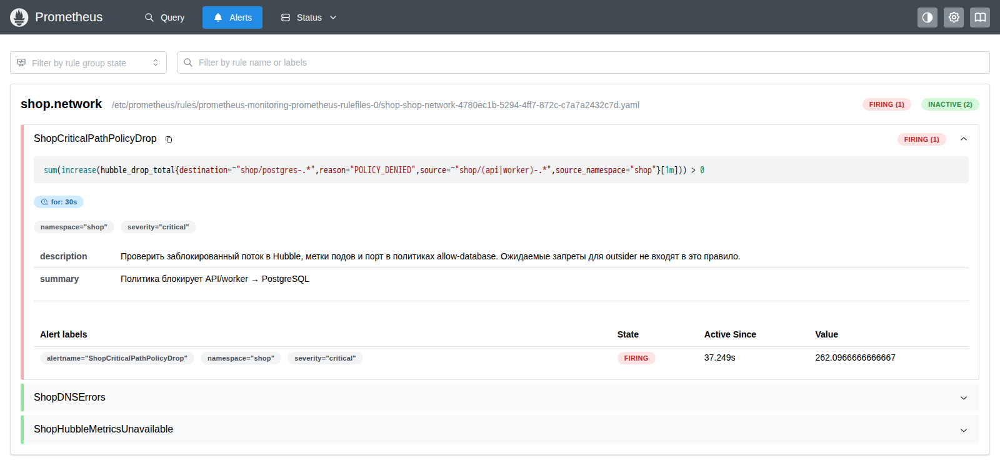

# Лабораторная работа № 5 - сеть Kubernetes

Задание: [Zero-trust сеть с доказательством](https://github.com/KeladKaal/containerization-and-orchestration/blob/2a723da2f5b9942ccfff5d43e0cc5bcfa88c0210/lecture-5-kubernetes-networking/lab.md).

В работе использован магазин `shop` из ЛР3–4: API записывает заказы в PostgreSQL, worker их обрабатывает. Проверена работа магазина при удалении подов, настроены сетевые политики и найдена намеренно внесённая ошибка связности.

## Часть 0 - CNI и стенд

Выбран Cilium 1.20.3: он применяет NetworkPolicy и даёт карту трафика Hubble. Calico также подходит для политик, но здесь удобнее встроенная наблюдаемость Cilium. Стандартный kindnet политики не применяет, поэтому для этой работы не подходит.

Стенд: Mac ARM64, VM Colima `lab5`, две ноды kind с Kubernetes 1.36.4. kube-proxy работает в режиме iptables, замена на балансировку Cilium отключена (`kubeProxyReplacement: false`). Сеть подов использует veth и VXLAN. Конфигурации: [kind.yaml](kind.yaml), [cilium-values.yaml](cilium-values.yaml).

## Часть 1 - приложение и сеть пода

В `shop` запущены три реплики API, две worker и один PostgreSQL через CloudNativePG. Ресурсы и `topologySpread` перенесены из ЛР4, реплики API распределены между нодами как 2+1. База включена в чарт: [postgres-cluster.yaml](shop/templates/postgres-cluster.yaml), параметры в [values.yaml](shop/values.yaml).

Для мониторинга использован один релиз `monitoring` с [настройками ЛР2](../lab-02-observability/observability/monitoring-values.yaml). Перед исследованием сети политики `shop` отключены:

```bash
# Команды выполняются внутри VM lab5.
helm upgrade --install shop ./shop -n shop --create-namespace \
  --set networkPolicy.enabled=false --wait
kubectl -n shop get pods -o wide
kubectl -n shop run client --image=nicolaka/netshoot:v0.14 \
  --labels=app=client --command -- sleep infinity
kubectl -n shop wait --for=condition=Ready pod/client --timeout=120s
```

PostgreSQL перешёл в `Cluster in healthy state`, PVC размером 1 GiB класса `standard` получил статус `Bound`. Контрольный `POST /order` вернул HTTP 201, затем у заказа появилось `processed: true`.

В образе API нет сетевых утилит, поэтому к поду добавлен диагностический ephemeral-контейнер с общим сетевым namespace. В командах `POD_API` и `IP_API_ДРУГОГО_УЗЛА` обозначают имя исходного пода и адрес пода другой ноды:

```bash
kubectl -n shop debug POD_API --image=nicolaka/netshoot:v0.14 \
  --container=netcheck --target=api --profile=general -- sleep infinity
kubectl -n shop exec POD_API -c netcheck -- ip -o addr show eth0
kubectl -n shop exec POD_API -c netcheck -- ip -o link show eth0
docker exec lab5-control-plane ip -o link show
kubectl -n shop exec POD_API -c netcheck -- \
  curl --max-time 3 http://IP_API_ДРУГОГО_УЗЛА:8080/health
```

У исходного пода зафиксированы IP `10.244.0.83/32` и `eth0@if37`. Парный интерфейс на ноде: `lxc2a06f83cdbca@if36`. Прямой запрос к `10.244.1.89:8080` на другой ноде вернул HTTP 200.



Сеть пода настраивается через CNI: Cilium выделяет свободный IP из диапазона ноды, создаёт veth и настраивает маршруты и eBPF-программы. Общего Linux-моста в этом режиме нет. Между нодами пакет переносится через VXLAN с сохранением внутренних IP подов. После удаления пода его адрес может быть использован повторно.

## Часть 2 - непрерывность при удалении подов

API опубликован через NodePort 30080. Через проброс kind и Colima он доступен с Mac по `http://127.0.0.1:18080`. Port-forward для клиентских запросов не использовался.

[load.sh](scripts/load.sh) отправляет заказы и записывает HTTP-код, код завершения curl и длительность в CSV. Повторов запросов нет; отказ соединения, тайм-аут или HTTP-код, отличный от 201, считаются ошибкой. [chaos-pods.sh](scripts/chaos-pods.sh) раз в пять секунд удаляет случайный под API или worker. PostgreSQL не затрагивается, принудительное удаление не применяется.

В течение 180 секунд одновременно работали внутренний клиент по DNS, внешний клиент с Mac и скрипт удаления:

```bash
# В VM:
kubectl -n shop exec -i client -- sh -s -- \
  http://api.shop.svc.cluster.local:8080/order 180 0.1 \
  < scripts/load.sh > /tmp/lab5-internal.csv &
bash scripts/chaos-pods.sh 180 5 > /tmp/lab5-deletions.csv &
wait
```

Одновременно в отдельном терминале на Mac:

```bash
sh scripts/load.sh http://127.0.0.1:18080/order 180 0.1 \
  > /tmp/lab5-nodeport.csv
```

Первый эксперимент дал 14 ошибок внутреннего клиента при удалении API. Для устранения гонки добавлена пауза `preStop.sleep` на пять секунд: сервер продолжает принимать запросы, пока его адрес исключается из доступных адресов Service. В API также добавлено ожидание завершения `http.Server.Shutdown`.

| Запуск | Внутренний клиент: запросы / ошибки | NodePort: запросы / ошибки | Удалено подов |
| --- | --- | --- | --- |
| Исходный | 1609 / 14 | 1693 / 0 | 36 |
| Итоговый, с политиками и исправленным API | **1702 / 0** | **1554 / 0** | **36** |

В итоговом запуске удалены 19 подов API и 17 worker с 36 разными именами и 35 различными IP.



Связь сохранилась за счёт нескольких компонентов:

- Service даёт стабильный ClusterIP и выбирает поды по метке `app=api`.
- EndpointSlice хранит адреса подов и их готовность; адрес удаляемого пода перестаёт использоваться для новых соединений.
- kube-proxy обновляет правила перенаправления в ядре по Service и EndpointSlice.
- CoreDNS возвращает ClusterIP по имени `api.shop.svc.cluster.local`, независимо от смены IP подов.

Обновление правил занимает время, поэтому понадобилась пауза перед остановкой API. Сам Service не гарантирует отсутствие потерь при удалении пода.

Режим iptables проверен по ConfigMap и строке `Using iptables Proxier` в логе. При большом числе сервисов длинные цепочки правил увеличивают затраты на обработку новых соединений и обновления. IPVS использует специализированные таблицы балансировки; сравнение производительности режимов здесь не проводилось.

Типы Service отличаются способом доступа:

- NodePort открывает порт на нодах; в kind дополнительно нужен проброс наружу.
- LoadBalancer требует внешнего балансировщика, который обычный kind сам не предоставляет.
- Headless (`clusterIP: None`) возвращает через DNS адреса подов, а выбор адреса и переподключение выполняет клиент.

## Часть 3 - целевая матрица доступа

До применения политик под `outsider` смог подключиться к `postgres-rw:5432`:

```bash
kubectl -n shop run outsider --image=nicolaka/netshoot:v0.14 \
  --labels=app=outsider --command -- sleep infinity
kubectl -n shop wait --for=condition=Ready pod/outsider --timeout=120s
kubectl -n shop exec outsider -- nc -zv -w 2 postgres-rw.shop.svc.cluster.local 5432
```

Затем составлена матрица: клиенту нужен API, API и worker нужна база, остальные прикладные связи закрыты.

| Источник | API:8080 | worker:8080 | PostgreSQL:5432 |
| --- | --- | --- | --- |
| client | Разрешён | Запрещён | Запрещён |
| API | Запрещён | Запрещён | Разрешён |
| worker | Запрещён | Запрещён | Разрешён |
| PostgreSQL | Запрещён | Запрещён | Не проверяется |
| outsider | Запрещён | Запрещён | Запрещён |
| client из untrusted | Запрещён | Запрещён | Запрещён |

Для API и worker обращение к своему компоненту означает другую реплику, не сам исходный под. Локальные обращения пода к самому себе в матрицу не входят.

Дополнительно разрешены необходимые связи:

- все поды `shop` → CoreDNS в `kube-system`, UDP/TCP 53: поиск сервисов;
- Prometheus из `monitoring` → API и worker, TCP 8080: сбор метрик;
- оператор из `cnpg-system` → PostgreSQL, TCP 8000: управление базой;
- PostgreSQL → Kubernetes API, TCP 443/6443: работа CloudNativePG;
- внешний клиент через NodePort → API, TCP 8080: отправка заказов.

## Часть 4 - сетевые политики

В [network-policies.yaml](shop/templates/network-policies.yaml) заданы default-deny для ingress/egress и точечные разрешения из матрицы. DNS разрешён отдельной [CiliumNetworkPolicy](shop/templates/dns-policy.yaml); через DNS-прокси Cilium запросы и ответы видны в Hubble. Метки, порты и адреса вынесены в [values.yaml](shop/values.yaml).

В разрешениях Prometheus и оператора `namespaceSelector` и `podSelector` находятся в одном элементе `from`. Поэтому проверяются одновременно namespace и метки пода, а не одно из этих условий.

```bash
helm lint ./shop
helm --kube-context kind-lab5 upgrade shop ./shop -n shop -f shop/values.yaml --wait
kubectl -n shop get networkpolicy,ciliumnetworkpolicy
```

В итоговых values стоит `networkPolicy.enabled=true`. Доступ PostgreSQL к Kubernetes API разрешён через сущность Cilium `kube-apiserver` на TCP 443/6443, без привязки к IP ноды.

Для NodePort выбран `externalTrafficPolicy: Local`: после NAT источник определяется как шлюз Docker `172.18.0.1`. Ему открыт только TCP 8080 к API. На ноде с опубликованным портом должна быть готовая локальная реплика API, иначе этот вход станет недоступен.

## Часть 5 - проверка матрицы

[check_matrix.py](scripts/check_matrix.py) проверяет подключения из исходных подов, включая все реплики API и worker. Для минимальных образов используются диагностические контейнеры в том же сетевом namespace. DNS проверяется по UDP и TCP; ошибка разрешения имени записывается как `ERROR`, а не как сетевой запрет.

```bash
kubectl create namespace untrusted
kubectl -n untrusted run impostor --image=nicolaka/netshoot:v0.14 \
  --labels=app=client --command -- sleep infinity
kubectl -n untrusted wait --for=condition=Ready pod/impostor --timeout=120s
python3 scripts/check_matrix.py
```

Получено **57/57 совпадений**: 28 разрешений и 29 запретов, без `ERROR`. Результат прикладных подключений:

| Источник | API:8080 | worker:8080 | PostgreSQL:5432 |
| --- | --- | --- | --- |
| client | Разрешён | Запрещён | Запрещён |
| API | Запрещён | Запрещён | Разрешён |
| worker | Запрещён | Запрещён | Разрешён |
| PostgreSQL | Запрещён | Запрещён | Не проверяется |
| outsider | Запрещён | Запрещён | Запрещён |
| client из untrusted | Запрещён | Запрещён | Запрещён |

Результаты совпали с целевой матрицей. Служебные подключения также проверены; доступ PostgreSQL к Kubernetes API проверялся через Service на 443, прямой 6443 отдельно не проверялся. Межкомпонентные запросы шли по DNS-именам Service, а между репликами одного компонента по прямому IP другой реплики.

Под из `untrusted` не получил доступа даже с меткой `app=client`; попытка обхода через NodePort тоже заблокирована. Успешный заказ с Mac подтвердил внешний вход.

[Полная матрица проверок](docs/screenshots/part-05-matrix.png).

## Часть 6 - скрытая поломка

[break-network.sh](scripts/break-network.sh) случайно выбирает неверную метку источника, метку адресата, отключение DNS или порт 5433 вместо 5432. Изменение применяется временным values-файлом; основной файл остаётся рабочим. При каждом из четырёх вариантов заказы переставали проходить. После возврата основных values запрос снова получал HTTP 201.

Для наблюдения Hubble Relay проброшен на локальный порт 4245 командой `kubectl -n kube-system port-forward svc/hubble-relay 4245:80` в отдельном терминале. После случайного запуска вариант до диагностики не просматривался:

```bash
bash scripts/break-network.sh
kubectl -n shop exec client -- curl --max-time 6 -H 'Content-Type: application/json' \
  -d '{"item":"blind-diagnosis"}' http://api.shop.svc.cluster.local:8080/order
hubble observe --server 127.0.0.1:4245 --from-namespace shop \
  --verdict DROPPED --since 20s -o compact
kubectl -n shop get networkpolicy allow-database-egress allow-database-ingress -o yaml
```

Диагностика:

1. Заказ получил HTTP 500 с `failed to store order`. Запрос до API дошёл, но запись в базу не прошла.
2. Hubble показал `DROPPED / POLICY_DENIED` для worker `10.244.1.174` → PostgreSQL `10.244.1.236:5432`. Значит, блокировалось соединение с базой.
3. У PostgreSQL проверены метка `app=postgres` и порт 5432. В политиках адресатом оказался `app=unknown-destination`. Источники и порт были правильными, ошибка найдена в селекторе адресата.
4. После возврата основных values заказ `blind-repaired` получил HTTP 201 и `processed: true`. Последующая проверка матрицы дала 57/57.



Другие красные связи на карте относятся к ожидаемым запретам матрицы. Для восстановления применены рабочие values и повторно проверена матрица:

```bash
helm --kube-context kind-lab5 upgrade shop ./shop -n shop -f shop/values.yaml --wait
python3 scripts/check_matrix.py
```

## Часть 7 - мониторинг и алерты

В чарт добавлены [ServiceMonitor](shop/templates/network-service-monitor.yaml), [PrometheusRule](shop/templates/network-prometheus-rule.yaml) и [дашборд Grafana](shop/files/shop-network.json). Метка `release: monitoring` подключает сбор к Prometheus, а `grafana_dashboard=1` позволяет Grafana импортировать панель автоматически.

С Hubble собираются сетевые события, TCP SYN, блокировки политиками и DNS-запросы/ответы; доступность сбора показана отдельно для каждой ноды. Это сетевые метрики, не счётчик клиентских HTTP-запросов. NXDOMAIN может появляться при переборе DNS-суффиксов и сам по себе не означает отказ сервиса.

На дашборде сначала виден нагрузочный прогон, затем проверки матрицы и блокировки доступа к базе. Пики блокировок относятся к этим проверкам.



| Алерт | Условие и выдержка | Обоснование |
| --- | --- | --- |
| `ShopCriticalPathPolicyDrop` | Есть блокировки API/worker → PostgreSQL за 1 минуту, `for: 30s`, critical | Этот путь должен быть разрешён; его блокировка мешает заказам. Запреты outsider не учитываются |
| `ShopDNSErrors` | Более 5% ошибочных DNS-ответов за 2 минуты либо блокировки к CoreDNS за 1 минуту, `for: 1m`, critical | Без DNS приложения не находят сервисы. Обычный NXDOMAIN исключён |
| `ShopHubbleMetricsUnavailable` | Ошибка или потеря сбора хотя бы с одной ноды, `for: 1m`, warning | Отсутствие измерений нельзя принимать за отсутствие сетевых проблем |

Для проверки `ShopCriticalPathPolicyDrop` временно разрешён порт 5433 вместо 5432 (`BREAK_CASE=4`). Заказ вернул HTTP 500, алерт перешёл из `pending` в `firing`. После восстановления доступа заказ снова получил HTTP 201, а правило вернулось в `inactive`. Задержка снятия алерта связана с минутным окном расчёта.



После восстановления [все три правила неактивны](docs/screenshots/part-07-alert-resolved.png). Два других правила проверены через promtool на моделируемых рядах, без отдельного вызова на стенде.

## Выводы

Магазин продолжил принимать заказы при штатном пересоздании подов. Сетевые политики ограничили доступ по матрице, а намеренная ошибка найдена по потоку Hubble и селекторам. Мониторинг и алерты включены в чарт `shop`.

Проверка относится к описанной нагрузке и удалению подов. Отказ ноды или диска не проверялся; один PostgreSQL с локальным хранилищем остаётся ограничением стенда.
