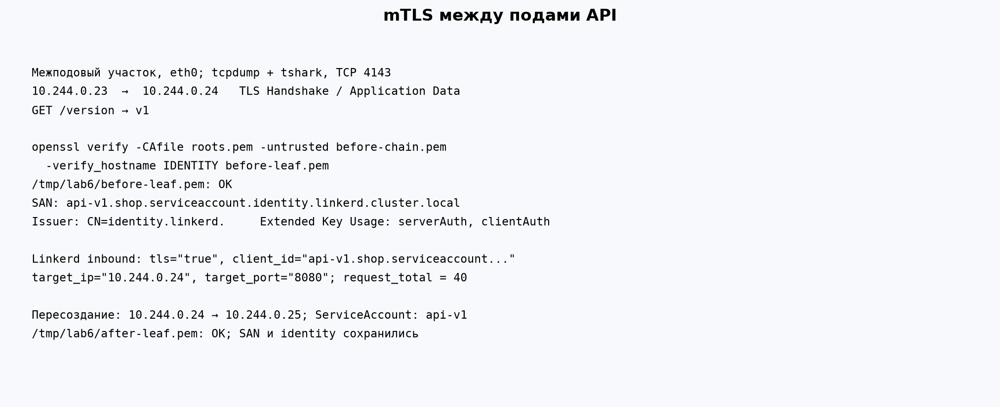
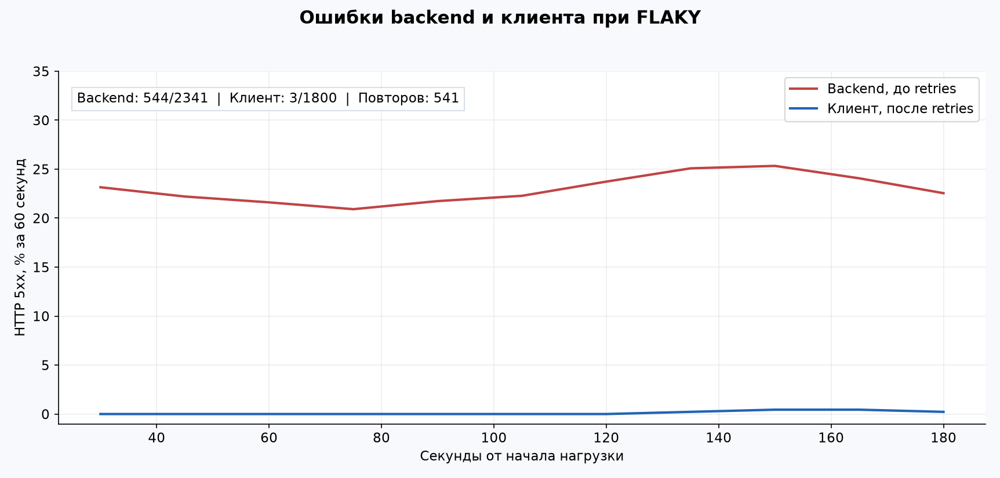
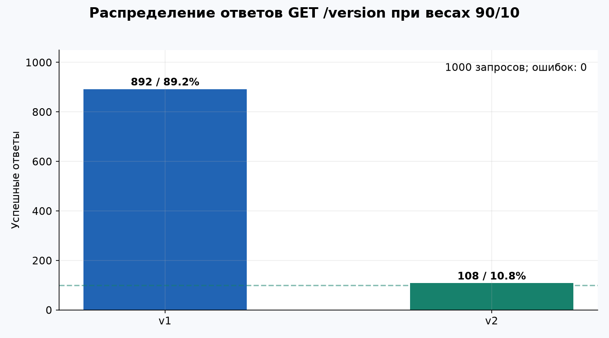
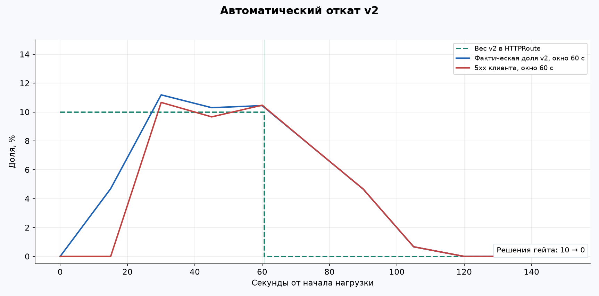
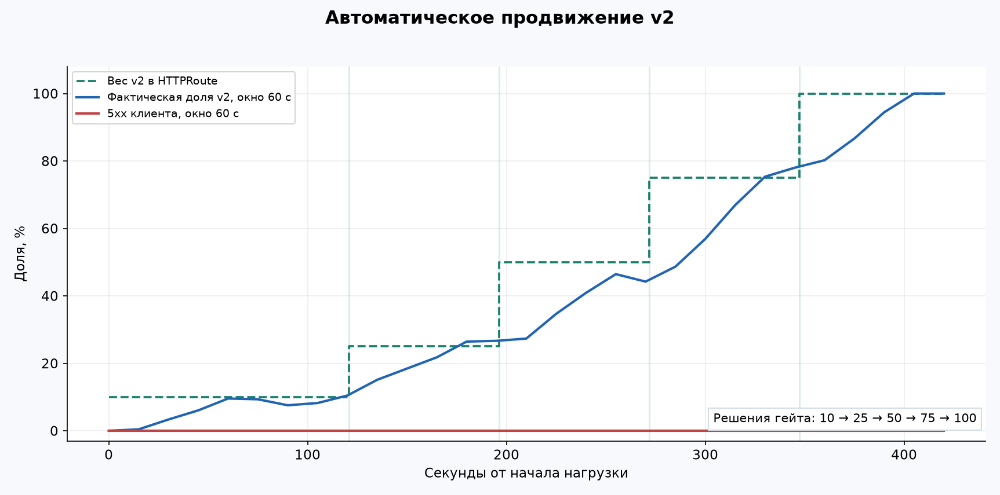
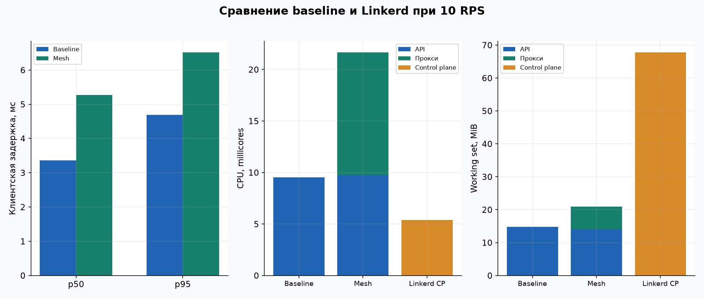
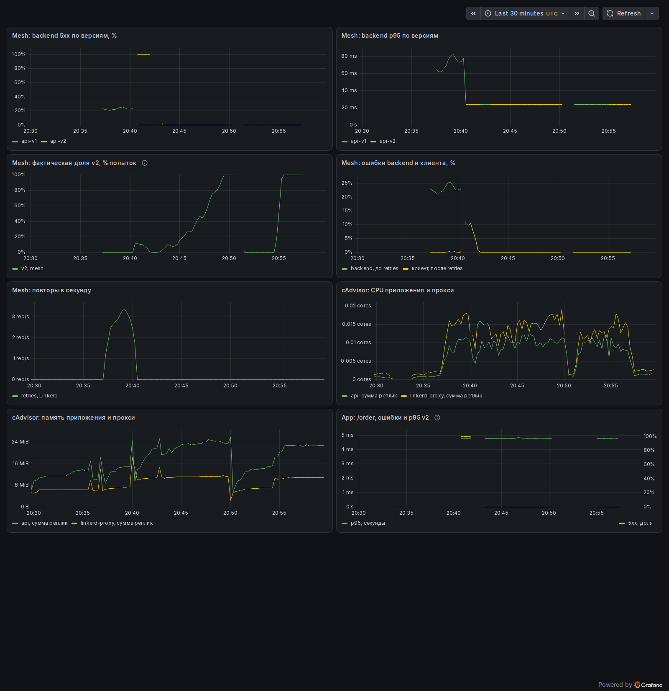

# Лабораторная работа № 6: service mesh и автопилот релиза

Задание: [Автопилот релиза](https://github.com/KeladKaal/containerization-and-orchestration/blob/2a723da2f5b9942ccfff5d43e0cc5bcfa88c0210/lecture-6-service-mesh/lab.md).

На магазине `shop` проверены шифрование между подами API, повторы при случайных ошибках и автоматический канареечный релиз. Затем измерены задержка и потребление ресурсов с Linkerd относительно baseline.

Команды выполняются из каталога работы внутри VM `lab6`.

## Часть 0. Сервисы

В [API](api/main.go) из ЛР5 добавлены ручка `/version` и два режима отказа для проверки повторов и отката релиза.

| Запрос | Результат |
| --- | --- |
| `GET /version` | `v1` или `v2`, согласно `VERSION` |
| `GET /health` | HTTP 200; `FAIL` и `FLAKY` на него не влияют |
| `POST /order` | Принимает `{"item":"tea"}`, записывает заказ, отвечает 201 |
| `GET /orders` | Возвращает сохранённые заказы |
| `GET /metrics` | Счётчики ответов и гистограмма задержки |

У v2 с `FAIL=true` корректный заказ получает 500. У v1 с `FLAKY=true` отказ выбирается случайно с вероятностью 25%. Обе проверки стоят после проверки JSON и `item`, но до SQL-записи. Поэтому намеренно сломанный запрос не оставляет заказ, который повтор затем продублирует. Неверное тело и пустой `item` по-прежнему получают 400.

Обе версии используют один [Dockerfile](api/Dockerfile) и один образ `shop-api:lab6`. В чарте отличаются переменные окружения, ServiceAccount и метки `version`. Шифрование и повторы выполняет Linkerd.

```bash
docker build -t shop-api:lab6 ./api
kind load docker-image --name lab6 shop-api:lab6
docker build -t shop-gate:lab6 ./gate
```

[Гейт](gate/gate.py) читает метрики Prometheus и меняет вес v2 через Helm. Его [образ](gate/Dockerfile) содержит Python, Helm и kubectl.

## Часть 1. Выбор mesh и стенд

Выбран Linkerd: для двух версий API достаточно прокси у прикладных подов и одного control plane. L7-маршрутизация и повторы доступны через Gateway API. У Istio ambient для такого разделения понадобился бы дополнительный waypoint.

Использована открытая сборка `edge-25.5.5` для ARM64. Маршрутизация настроена через Gateway API `HTTPRoute` на Kubernetes 1.32.2 и Gateway API 1.2.1.

| Компонент | Версия или настройка |
| --- | --- |
| Colima VM `lab6` | ARM64, 6 CPU, 12 GiB RAM, диск 50 GiB |
| kind / Kubernetes | 0.27.0 / 1.32.2, одна control-plane нода |
| Helm | 3.17.2 |
| Linkerd | edge-25.5.5 |
| Gateway API | 1.2.1 |
| CloudNativePG | chart 0.23.2, оператор 1.25.1 |
| PostgreSQL | 17.4, один экземпляр |
| kube-prometheus-stack | chart 91.8.2, релиз `monitoring` |
| Prometheus / Grafana | 3.15.0 / 13.2.3 |
| Go для тестов / promtool | 1.25.6 / 3.15.0 |

Одноузловой кластер создан по [kind.yaml](kind.yaml), контекст `kind-lab6`. PostgreSQL развёрнут через CloudNativePG. URI подключения API получает из Secret `postgres-app`, который создаёт оператор.

Мониторинг установлен релизом `monitoring` с [настройками ЛР2](../lab-02-observability/observability/monitoring-values.yaml):

```bash
helm --kube-context kind-lab6 upgrade --install monitoring \
  oci://ghcr.io/prometheus-community/charts/kube-prometheus-stack \
  --version 91.8.2 -n monitoring --create-namespace \
  -f ../lab-02-observability/observability/monitoring-values.yaml \
  --wait --timeout 10m
```

Настройки ресурсов VM и приложения во время сравнения не менялись. У каждой реплики API requests и limits равны `200m` CPU и `100Mi` памяти.

## Часть 2. Baseline без mesh

Сначала развёрнуты две здоровые реплики v1 и PostgreSQL. Linkerd на момент этого замера ещё не был установлен. v2, искусственные ошибки и повторы выключены:

```bash
helm --kube-context kind-lab6 upgrade --install shop ./shop \
  -n shop --create-namespace --set mesh.enabled=false \
  --set api.v1.replicas=2 --set api.v2.replicas=0 \
  --set api.v1.flaky=false --set traffic.v2Weight=0 --wait
kubectl --context kind-lab6 -n shop \
  wait --for=condition=Ready cluster/postgres --timeout=180s
```

Первый контрольный заказ `lab6-check` получил HTTP 201 и `id=1`. PostgreSQL перешёл в `Cluster in healthy state`.

[Генератор](scripts/load.py) запускается в диагностическом контейнере `load` внутри пода API. После включения mesh запросы генератора проходят через прокси этого пода.

```bash
# POD: имя готового, не удаляемого пода api-v1.
kubectl --context kind-lab6 -n shop debug "$POD" \
  --image=python:3.12-alpine --container=load --target=api \
  --profile=general -- sleep infinity
kubectl --context kind-lab6 -n shop exec -i "$POD" -c load -- \
  python3 - --url http://api:8080 --rate 10 --duration 30 \
  --output /tmp/warmup.csv < scripts/load.py
kubectl --context kind-lab6 -n shop exec -i "$POD" -c load -- \
  python3 - --url http://api:8080 --rate 10 --duration 180 \
  --output /tmp/baseline.csv < scripts/load.py
```

Отправка привязана ко времени старта, а не к завершению прошлого запроса. Тайм-ауты и неотправленные вовремя запросы считаются ошибками; повторов у генератора нет. После пересоздания API диагностический контейнер добавлялся к новому поду тем же способом.

| Показатель baseline | Результат |
| --- | --- |
| Прогрев | 30 с, 300 запросов, 0 ошибок |
| Измерение | 180 с, 1800 запросов, 0 ошибок |
| Клиентский p50 / p95 | 3,36 / 4,69 мс |
| CPU двух контейнеров API, среднее | 9,52m |
| Working set двух контейнеров API, среднее | 14,83 MiB |

Задержка измерена у клиента. Ресурсы взяты из cAdvisor через Prometheus: CPU из `rate(container_cpu_usage_seconds_total[1m])`, память из `container_memory_working_set_bytes`. Сумма реплик усреднена по 180 секундам, шаг 15 секунд. Контейнер `load` в сумму не входит.

## Часть 3. mTLS и identity

После baseline установлены Gateway API и Linkerd:

```bash
kubectl --context kind-lab6 apply -f \
  https://github.com/kubernetes-sigs/gateway-api/releases/download/v1.2.1/standard-install.yaml
linkerd --context kind-lab6 install --crds | \
  kubectl --context kind-lab6 apply -f -
linkerd --context kind-lab6 install --values ./linkerd-values.yaml | \
  kubectl --context kind-lab6 apply -f -
linkerd --context kind-lab6 check --wait=5m
helm --kube-context kind-lab6 upgrade shop ./shop -n shop \
  --reuse-values --set mesh.enabled=true --wait
```

`linkerd check` подтвердил готовность control plane и совпадение версий CLI и прокси. CLI также сообщил о доступной более новой сборке `edge-26.10.1`; на стенде установлена `edge-25.5.5`. В каждом поде API появились два готовых контейнера. Linkerd добавляет прокси по аннотации в [шаблоне API](shop/templates/api.yaml).

Проверка выполнена между разными подами: источник `10.244.0.23`, получатель `10.244.0.24`. В `netcheck` снят трафик на `eth0`, на межпрокси-порту 4143. `tshark` распознал TLS handshake и зашифрованные записи.

Публичный сертификат получателя получен через диагностический TLS-порт 4191. Проверены подпись по корню стенда и имя из SAN:

```bash
openssl verify -CAfile roots.pem -untrusted before-chain.pem \
  -verify_hostname api-v1.shop.serviceaccount.identity.linkerd.cluster.local \
  before-leaf.pem
# before-leaf.pem: OK
linkerd --context kind-lab6 identity -n shop "$POD_DEST"
```

Сертификат содержит `DNS:api-v1.shop.serviceaccount.identity.linkerd.cluster.local`, издатель `CN=identity.linkerd.`, назначения `TLS Web Server Authentication` и `TLS Web Client Authentication`. В метрике входящего прокси для того же адресата есть `tls="true"` и `client_id="api-v1.shop.serviceaccount.identity.linkerd.cluster.local"`. Для этого соединения подтверждены шифрование и identity другой стороны.

После удаления пода получателя новый получил IP `10.244.0.25`. ServiceAccount остался `api-v1`, SAN не изменился, повторная проверка сертификата вернула `OK`.



## Часть 4. Надёжность при FLAKY

На v1 включён `FLAKY=true`, а на HTTPRoute включены повторы 5xx, максимум три повтора после исходного запроса:

```bash
helm --kube-context kind-lab6 upgrade shop ./shop -n shop \
  --reuse-values --set api.v1.flaky=true \
  --set mesh.retries.enabled=true --wait
```

За 180 секунд клиент отправил 1800 заказов. Прокси сделал 2341 попытку обращения к backend; 544 ответа были 500, то есть **23,24%**. До клиента дошли **3 ошибки из 1800, 0,17%**.



На графике показаны две метрики одной исходящей стороны: `outbound_http_route_backend_response_statuses_total` считает ответы отдельных попыток, а `outbound_http_route_request_statuses_total` считает конечный результат запроса. Окно обеих долей 60 секунд. Клиентский CSV подтвердил те же три ошибки.

Механизм виден по собственным метрикам Linkerd: `outbound_http_route_retry_requests_total` вырос на **541**, `outbound_http_route_retry_successes_total` на **417**. Число попыток равно `1800 + 541`.

Число строк в БД выросло с 2101 до 3898, ровно на 1797 успешных клиентских запросов. Вынужденные отказы не создали дополнительных заказов.

## Часть 5. Разделение 90/10

Перед канарейкой `FLAKY` и повторы выключены, обе версии здоровы. Иначе повтор на v1 мог бы скрыть ошибку v2 и исказить долю версий.

```bash
helm --kube-context kind-lab6 upgrade shop ./shop -n shop \
  --reuse-values --set api.v1.flaky=false \
  --set mesh.retries.enabled=false --set api.v2.replicas=1 \
  --set api.v2.fail=false --set traffic.v2Weight=10 --wait
kubectl --context kind-lab6 -n shop exec -i "$POD" -c load -- \
  python3 - --url http://api:8080 --versions 1000 \
  --output /tmp/split.csv < scripts/load.py
```

[HTTPRoute](shop/templates/mesh-http-route.yaml) привязан к общему Service `api`. Его backend Service `api-v1` и `api-v2` выбирают поды соответствующей версии. Вес v1 вычисляется как `100 - traffic.v2Weight`. Значения вне 0–100, дробные и нечисловые значения отклоняются при рендеринге чарта.

Получены **892 ответа v1 и 108 ответов v2**, ошибок нет. Наблюдаемая доля v2 **10,8%**, в пределах принятого диапазона 7–13%.



## Часть 6. Логика гейта

Гейт раз в 15 секунд читает Prometheus. Для решений используются прикладные метрики только `path="/order"`, `version="v2"`, `service="api-v2"`: `shop_http_requests_total` и `shop_http_request_duration_seconds_bucket`. Пробы и `/version` не учитываются. Метку версии переносит ServiceMonitor из меток пода.

| Условие за последние 60 с | Решение |
| --- | --- |
| Меньше 50 запросов, нет серий, scrape старше 30 с или один из ожидаемых target не UP | Сохранить вес, сбросить серию хороших проверок; после 120 с без пригодных данных завершиться с ошибкой |
| 5xx выше 5% или p95 выше 600 мс | Установить v2=0 и закончить сценарий откатом |
| 5xx ниже 1% и p95 не выше 300 мс, две проверки подряд | Следующий вес: 10 → 25 → 50 → 75 → 100% |
| Промежуточные значения | Сохранить вес, сбросить серию хороших проверок |
| После старта или смены веса прошло меньше 60 с | Ждать полного нового окна |

При достаточном числе запросов NaN/Inf считаются ошибкой данных, продвижение запрещено. Пустая гистограмма при недостатке запросов означает ожидание. Недоступный Prometheus, повреждённый ответ или ошибка Helm завершают гейт с ненулевым кодом.

Порог 300 мс взят из SLA ЛР4. Верхние пороги 600 мс и 5% отделяют явную деградацию от промежуточного состояния.

```bash
python3 gate/gate.py --prometheus http://127.0.0.1:19090 --chart ./shop
```

Prometheus доступен через `kubectl --context kind-lab6 -n monitoring port-forward --address 127.0.0.1 svc/monitoring-prometheus 19090:9090`. Скрипт вызывает `helm upgrade --reuse-values --set traffic.v2Weight=...`, сохраняя остальные настройки релиза. После обновления скрипт читает вес из объекта и проверяет, что применено нужное число.

## Часть 7. Откат и докат

Каждый сценарий начинался с 90/10 и нового окна наблюдения. После запуска гейта веса вручную не менялись.

У плохой v2 выставлен `FAIL=true`. На первой полной проверке гейт увидел около 65,77 запроса v2 за окно, долю 5xx=100% и p95 4,75 мс. Задержка была нормальной, откат вызвала именно доля ошибок. Примерно через 61 секунду v2 получила вес 0. Контрольные 100 запросов `/version` после сценария вернули только v1.

За весь 150-секундный прогон было 1500 заказов и 65 ошибок, все до отвода трафика. После отката v1 продолжила принимать заказы.



Затем у v2 выключен `FAIL`, вес возвращён в 10% и запущен новый гейт. Он сам прошёл **10 → 25 → 50 → 75 → 100%**. Решения о продвижении пришлись примерно на 121, 196, 272 и 347 секунды от начала нагрузки. Первые окна иногда содержали меньше 50 запросов v2: гейт ждал и сбрасывал серию хороших проверок, а не продвигал релиз по одному таймеру.

В 420-секундном прогоне отправлено **4200 заказов, ошибок нет**. Контрольные 100 запросов `/version` вернули только v2. В обоих сценариях сравнение сохранённых Helm values до и после работы гейта подтвердило: изменился только раздел `traffic`; флаги отказов и остальные настройки остались прежними.



Линия фактической доли считается по минутному окну, поэтому она отстаёт от ступени веса. На графиках ошибок показан конечный результат клиента, не сумма входящих и исходящих метрик одного запроса.

## Часть 8. Цена mesh

После сценариев восстановлены две здоровые реплики v1, v2=0, `FLAKY=false` и выключенные повторы. Перед сравнением поды API пересозданы, затем выдержана пауза до исчезновения метрик старых контейнеров. Повторены прогрев 30 с и нагрузка 10 RPS в течение 180 с. Ресурсы приложения, тело заказа и PostgreSQL остались прежними.

С mesh получено **1800 ответов 201, ошибок нет**. CPU и память приложения и двух прокси посчитаны раздельно. Контейнер генератора исключён, весь namespace `linkerd`, включая его служебные прокси, показан как control plane.

| Показатель | Baseline | С mesh | Разница | Изменение |
| --- | --- | --- | --- | --- |
| Клиентский p50, мс | 3,36 | 5,27 | +1,91 | +57,0% |
| Клиентский p95, мс | 4,69 | 6,52 | +1,82 | +38,8% |
| CPU API, m | 9,52 | 9,75 | +0,23 | +2,5% |
| CPU двух прокси, m | 0 | 11,92 | +11,92 | Не определено |
| CPU API + прокси, m | 9,52 | 21,67 | +12,15 | +127,7% |
| Память API, MiB | 14,83 | 14,07 | −0,76 | −5,2% |
| Память двух прокси, MiB | 0 | 6,86 | +6,86 | Не определено |
| Память API + прокси, MiB | 14,83 | 20,93 | +6,10 | +41,1% |
| CPU control plane Linkerd, m | 0 | 5,39 | +5,39 | Не определено |
| Память control plane Linkerd, MiB | 0 | 67,80 | +67,80 | Не определено |
| CPU API + прокси + control plane, m | 9,52 | 27,06 | +17,54 | +184,3% |
| Память API + прокси + control plane, MiB | 14,83 | 88,73 | +73,90 | +498,2% |

Здесь `m` означает millicores, 1000m равны одному ядру. Проценты посчитаны по неокруглённым значениям; при нулевом baseline относительная разница не вычисляется. В таблице нет ресурсов неизменных PostgreSQL и мониторинга.

p95 вырос на 1,82 мс, до 6,52 мс, и остался далеко ниже порога 300 мс. Основная постоянная добавка по памяти пришлась на control plane. Уменьшение working set самого Go-процесса на 0,76 MiB не означает, что mesh экономит память: это один локальный прогон, на него влияют сборка мусора, кэши и фоновая активность VM.

Для магазина из одного API и базы постоянный mesh избыточен, если задача только принимать 10 заказов в секунду: baseline уже дал ноль ошибок, а полная память выросла почти в шесть раз. Его смысл здесь в проверенных функциях: identity по сертификату, повторах без изменения клиента и управлении долей релиза.



## Часть 9. Мониторинг и проверки

В чарт добавлены [ServiceMonitor](shop/templates/service-monitor.yaml), [три правила](shop/templates/mesh-prometheus-rule.yaml) и [дашборд](shop/files/shop-mesh.json). Метрики приложения и mesh собирает Prometheus релиза `monitoring`. Метки `release: monitoring` и `grafana_dashboard: "1"` подключают объекты к существующему стеку.

Дашборд использует следующие метрики:

- `outbound_http_route_backend_response_statuses_total` для ошибок backend по `backend_name`;
- `outbound_http_route_backend_response_duration_seconds_bucket` для задержки по backend;
- `outbound_http_route_backend_requests_total` для фактического разделения трафика;
- `outbound_http_route_request_statuses_total` для клиентского результата после повторов;
- `outbound_http_route_retry_requests_total` для числа повторов;
- метрики cAdvisor для CPU и памяти контейнеров API и `linkerd-proxy`.

Первый бакет гистограммы Linkerd заканчивается на 25 мс. У быстрых ответов оценка p95 ограничена этим разрешением, поэтому таблица цены построена по CSV клиента, а не по гистограмме mesh.

Считается только исходящая сторона HTTPRoute `api`. Метка `version` у исходящего прокси относится к источнику, поэтому версии назначения разделены по `backend_name`, а не по этой метке. У метрик mesh нет `path`; панели подписаны как метрики маршрута API целиком. При повторах доля backend означает долю попыток. Прикладная панель `/order` подписана отдельно.

| Алерт | Условие и выдержка | Зачем нужен |
| --- | --- | --- |
| `ShopCanaryHighErrorRate` | 5xx v2 выше 5% за 1 минуту, не менее 50 заказов, `for: 30s` | Показывает неудачную версию, а не сбой пробы |
| `ShopCanaryHighLatency` | p95 v2 выше 600 мс за 1 минуту, не менее 50 заказов, `for: 30s` | Обнаруживает медленную версию без обязательного роста ошибок |
| `ShopMeshMetricsUnavailable` | Успешно собирается меньше прокси, чем ожидается по репликам API, `for: 1m` | Не позволяет принять потерю наблюдаемости за отсутствие проблем; при `mesh.enabled=false` выключен |



Графики экспериментов построены по измерениям Prometheus, CSV клиента и журналам гейта. На снимке Grafana видны ошибки при FLAKY, откат плохой v2, продвижение здоровой версии и потребление ресурсов во время нагрузки.

Проверки из каталога работы внутри VM:

```bash
(cd api && CGO_ENABLED=1 go test -race -count=1 ./...)
PYTHONDONTWRITEBYTECODE=1 python3 -m unittest discover -s gate -p 'test_*.py'
PYTHONDONTWRITEBYTECODE=1 python3 -m unittest discover -s scripts -p 'test_*.py'
helm lint ./shop
helm template shop ./shop -n shop > /tmp/lab6-final.yaml
kubectl --context kind-lab6 -n shop apply --dry-run=server -f /tmp/lab6-final.yaml
```

Тесты Go с `-race` и 24 теста Python завершились успешно. Чарт прошёл `helm lint`, рендеринг и серверный dry-run. Prometheus собирал метрики с трёх прикладных target и трёх прокси; у всех правил состояние `inactive`, `health=ok`, ошибок вычисления нет.

Срабатывания трёх алертов проверены через promtool на подготовленных временных рядах в [test_alerts.py](scripts/test_alerts.py). Сценарии покрывают норму, высокий процент ошибок, высокую задержку и потерю сбора метрик. При выключенном mesh алерт отсутствия его метрик остаётся неактивным.

После измерений применён финальный [values.yaml](shop/values.yaml): две реплики v1, одна v2, **100% трафика на v2**, `FAIL`, `FLAKY` и повторы выключены. Применённые настройки соответствовали файлу, HTTPRoute получил `Accepted=True`. Последние 1200 заказов прошли без ошибок, контрольные 100 ответов `/version` содержали только v2. Через `/orders` получены 12833 записи, включая первый заказ `lab6-check`.
